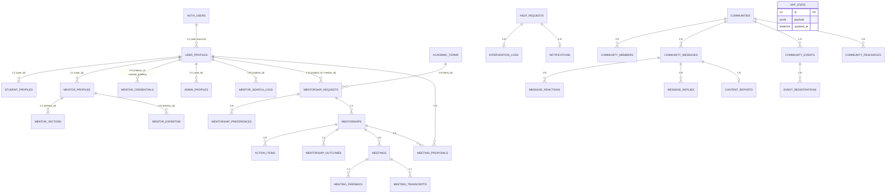

# IITM BS Mentoring Portal – Database Documentation

Source: `backend/supabase_setup.sql` (Supabase Postgres schema) plus the JSONB `app_state` prototype store.

## 1. Overview

The application uses **Supabase** as the single backend service:

- **Supabase Auth** – users/credentials.
- **Supabase Postgres** – relational tables (schema SQL).
- **Supabase Storage** – `mentoring-files` bucket.
- **pgvector** – mentor embeddings.

Additionally, a prototype JSONB document store (`app_state`) holds the whole working state used by
the React UI.

---

## 2. Mermaid ER Diagram (as defined in `supabase_setup.sql`)

## 3. Table-by-Table Reference

### 3.1 Identity & Access

| Table | Purpose | Key columns |
|---|---|---|
| `auth.users` | Supabase-managed auth identities | id, email, password hash, metadata |
| `user_profiles` | Application profile/roles | id (FK→auth.users), email, name, role, approved, active, avatar_url, phone, timestamps |
| `student_profiles` | Student academic/career info | id, user_id (unique), program, level, goals, interests[], timestamps |
| `mentor_profiles` | Mentor professional info | id, user_id (unique), title, role, field, industry, bio, background, linkedin, mode, slots, hours, available, ai_profile jsonb, profile_indexed_at, timestamps |
| `mentor_credentials` | Mentor credential verification | id, mentor_id, credential_type, title, issuer, year, document_url, verified, verified_by |
| `admin_profiles` | Admin assignments | id, user_id, department, permissions[] |

### 3.2 Academic & Matching

| Table | Purpose | Key columns |
|---|---|---|
| `academic_terms` | Terms | id, name, start_date, close_date, end_date, min_meetings, is_active |
| `preference_options` | Preference taxonomy | id, category, label, value, is_active |
| `mentorship_requests` | Requests | id, student_id, mentor_id, student_name, student_email, mentor_name, term_id, term_name, goal, message, preferences jsonb, status, timestamps |
| `mentorship_preferences` | Request preferences | id, request_id, preference_key, preference_value |
| `mentorships` | Mentorship relationships | id, request_id, student_id, mentor_id, term_id, status, start_date, end_date |
| `mentor_expertise` | Expertise/skills | id, mentor_id, skill, level, years |
| `career_goals` | Student career goals | id, student_id, goal_title, target_timeline, status |

### 3.3 AI / Search

| Table | Purpose | Key columns |
|---|---|---|
| `mentor_vectors` | Embeddings | id, mentor_id (unique→mentor_profiles), embedding vector(1536), extracted_metadata jsonb, updated_at |
| `mentor_search_logs` | Search audit | id, student_id, query, filters jsonb, result_count, created_at |

### 3.4 Meetings / Progress

| Table | Purpose | Key columns |
|---|---|---|
| `mentor_availability` | Availability slots | id, mentor_id, day_of_week, start_time, end_time, timezone |
| `meeting_proposals` | Proposals | id, mentorship_id, proposed_by, proposed_time, status |
| `meetings` | Meetings | id, mentorship_id, student_name, mentor_name, scheduled_at, status, meeting_link, notes |
| `meeting_feedback` | Feedback | id, meeting_id, submitted_by, rating, comments |
| `meeting_transcripts` | Transcripts | id, meeting_id, storage_path, summary |
| `action_items` | Tasks | id, mentorship_id, student_name, title, due_date, done |
| `mentorship_outcomes` | Outcomes | id, mentorship_id, rating, feedback, summaries |

### 3.5 Support / Community / Content

| Table | Purpose | Key columns |
|---|---|---|
| `help_requests` | Support tickets | id, user_id, user_name, user_email, role, ticket_type, description, status, reply, resolved_by |
| `intervention_logs` | Admin interventions | id, ticket_id, admin_id, action_taken, notes |
| `notifications` | Notifications | id, user_id, title, message, read, type |
| `communities` | Communities | id, name, description, category, visibility, creator_id, avatar_url, is_archived |
| `community_members` | Membership | id, community_id, user_id, role, status, joined_at |
| `community_messages` | Chat | id, community_id, sender_id, sender_name, content, is_pinned, created_at |
| `message_reactions` | Reactions | id, message_id, user_id, reaction, created_at |
| `message_replies` | Replies | id, parent_message_id, sender_id, sender_name, content |
| `community_events` | Events | id, community_id, title, description, event_date, location, meeting_link, host_id |
| `event_registrations` | Event signups | id, event_id, user_id |
| `community_resources` | Resources | id, community_id, title, resource_type, url, description, uploaded_by |
| `content_reports` | Reports | id, reported_by, community_id, message_id, reason, status |
| `conversations` | DMs / typed community conversations (migration 003) | id, type, community_id, created_by, status, created_at, updated_at, last_message_at |
| `conversation_participants` | DM membership | conversation_id, user_id, role, status, unread_count, last_read_at, joined_at |
| `direct_messages` | DM content | id, conversation_id, sender_id, sender_name, sender_role, content, reply_to_id, attachments jsonb, reactions jsonb, created_at, updated_at |
| `message_reads` | DM read receipts | conversation_id, user_id, last_read_message_id, last_read_at, updated_at |
| `notifications` | Notifications | id, user_id, title, message, read, type, link, payload |

### 3.6 Prototype State

| Table | Purpose | Key columns |
|---|---|---|
| `app_state` | JSONB working state | id (check id=1), payload jsonb, updated_at |

## 4. Indexes, RLS, Storage, pgvector

- **Indexes:** role/email, mentor field/industry/availability, request/student/mentor/status/term,
  meetings/action items/community messages/community members/help requests, conversations
  (type, created_by, last_message_at), conversation_participants (user, user+unread), direct_messages
  (conversation_id, created_at), message_reads (conversation_id, user_id).
- **pgvector:** `create extension vector`; `mentor_vectors.embedding vector(1536)`;
  HNSW index `idx_mentor_vectors_hnsw`; function `match_mentors(query_embedding, threshold, count)`.
- **RLS:** enabled on all listed tables with a subset of policies (mentor visibility, own profile,
  communities, mentorship requests, terms, plus messaging tables — conversations visible to
  participants, participants own-row, DMs participant-scoped, notifications own-row).
- **Storage:** bucket `mentoring-files` (private, 20 MB, allowed MIME list).

## 5. Key Relationships

- `user_profiles` 1:1 with `auth.users`; 1:1 with `student_profiles` / `mentor_profiles` / `admin_profiles`.
- `mentor_profiles` 1:N with `mentor_expertise`, 1:1 with `mentor_vectors`.
- `mentorship_requests` N:1 with `academic_terms`, 1:N with `mentorship_preferences`, 1:1 with `mentorships`.
- `communities` 1:N with members/messages/events/resources; messages 1:N with reactions/replies/reports.

## 6. Data Flow for Mentorship State

- Backend `get_state()`/`save_state()` operate on `app_state` (id=1, JSONB) – used by all workflow UI.
- Secondary relational tables exist for future normalized use but the current prototype writes mostly
  to `app_state` (and best-effort inserts into relational tables).

---

*End of DATABASE_DOCUMENTATION.md*
