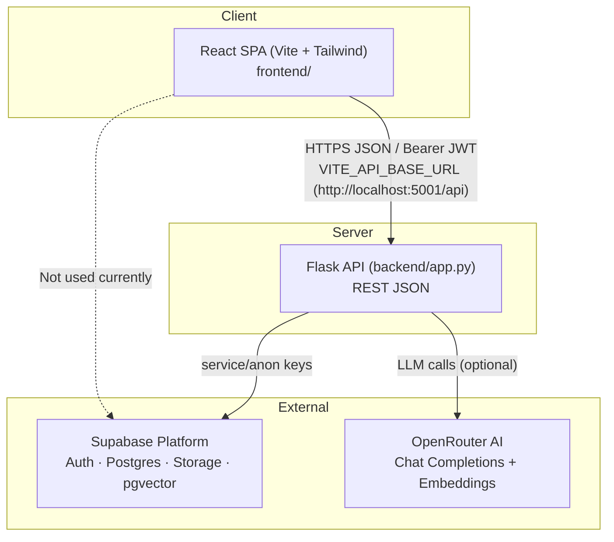
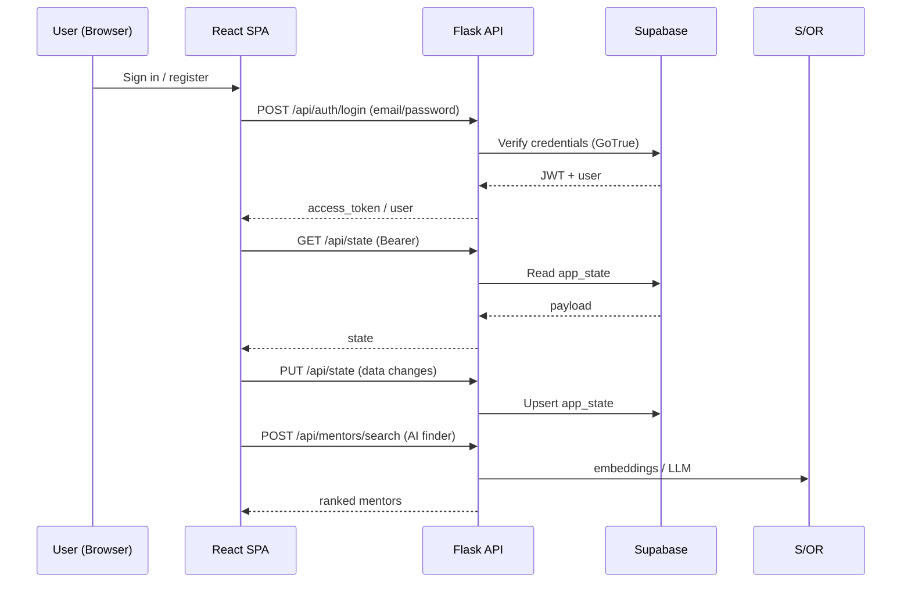
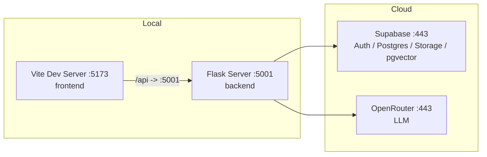

# IITM BS Mentoring Portal – System Architecture

## 1. High-Level Architecture

## 2. Component Overview

### 2.1 Frontend (`frontend/`)

- **Entry:** `src/main.jsx` → renders `src/App.jsx`.
- **Root component (`App.jsx`):** manages `user`, `data` (whole app state), `page`, auth forms,
  register/login, backend sync (`GET/PUT /api/state`), logout.
- **API client (`src/api.js`):** token storage (`mentoringToken` in localStorage), `apiRequest`
  (attach `Authorization: Bearer`, JSON body, error extraction), `apiLogin`, `apiRegister`, `apiMe`,
  `apiLogout`, `apiResetPassword`.
- **State fallback (`src/data.js`):** `starterData`, `localAccounts`, `loadData`, `navByRole`,
  `termLabel`.
- **UI primitives (`src/ui.jsx`):** `Panel`, `Title`, `Chip`, `DataTable`, `card`, `input`, `button`, `outline`.
- **Pages (`src/pages/`):**
  - `StudentPages.jsx`: `StudentHome`, `MentorDetails`, `StudentProfile`, `MyMentorship`, `HistoryPage`, `HelpPage`.
  - `MentorPages.jsx`: `MentorRequests`, `MyStudents`, `MentorProfile`.
  - `CommunityPage.jsx`: communities, chat, events, resources, reports.
  - `RecommendationChat.jsx`: AI Mentor Finder.
  - `AdminPages.jsx`: dashboard, approvals, students, mentors, help tickets, statistics, term settings.

### 2.2 Backend (`backend/app.py`)

Single-file Flask application organised into sections:

1. Environment & config validation (`SUPABASE_URL`, anon/service keys, `SECRET_KEY`, `FRONTEND_ORIGIN`,
   `OPENROUTER_API_KEY`, `OPENROUTER_MODEL`, `PORT`, `FLASK_DEBUG`).
2. State helpers (`default_state`, `get_state`, `save_state`, `get_profile`).
3. Auth helpers (`bearer_token`, `current_user`, `login_required`, `roles`).
4. OpenRouter + vector helpers (`openrouter_chat`, `openrouter_embedding`, `cosine_similarity`,
   `profile_text`, `tokenize`, `analyze_and_index_mentor`).
5. API endpoints grouped by module (auth, mentors, mentorship, communities, help, admin, terms, state).
6. Error handlers (404/405/500) and app runner.

### 2.3 External systems

- **Supabase Auth:** email/password sign-in; admin user creation (`auth.admin.create_user`).
- **Supabase Postgres:** tables defined in `supabase_setup.sql`; accessed via PostgREST client
  (`sb.table(...)...execute()`).
- **Supabase Storage:** bucket `mentoring-files` (private, 20 MB, PDF/PNG/JPG/DOCX etc.).
- **OpenRouter:** chat completions + `text-embedding-3-small` embeddings (optional; falls back to
  keyword search when unconfigured).

---

## 3. Runtime Flow

---

## 4. Frontend–Backend Interaction

- Base URL: `VITE_API_BASE_URL` (default `http://localhost:5001/api`).
- All requests: `fetch(API_BASE + path, { method, headers, body })` with JSON content type and
  Bearer token when present.
- Auth state persisted in `localStorage` key `mentoringToken`.
- App data persisted only in localStorage key `mentoringData` (fallback) plus backend `/api/state`.

---

## 5. Deployment Topology (Development)

---

## 6. Architectural Observations

- **Pattern:** API-led backend + client-side derived views over a single JSONB state document
  (prototype-grade).
- **CORS:** restricted to `FRONTEND_ORIGIN` (default `http://localhost:5173`).
- **Error handling:** JSON error bodies with HTTP status codes; 404/405/500 handlers registered.

---

*End of SYSTEM_ARCHITECTURE.md*
